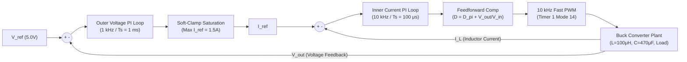
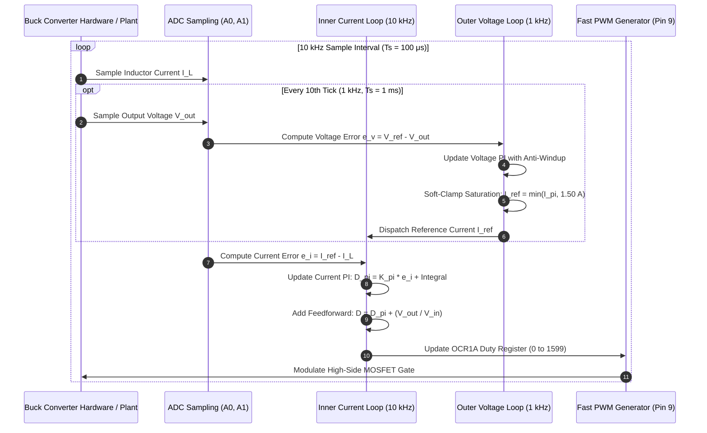

# Cascade (Dual-Loop) Voltage-Current Controlled Buck Converter

<p align="center">
  
  
  
  
  
  
</p>

A deterministic hardware, simulation, and discrete-time control engineering framework implementing **Cascade (Dual-Loop) Voltage-Current Control with Soft-Clamped Overcurrent Saturation** for a DC-DC Buck Converter ($12\text{V} \rightarrow 5\text{V}$, $1.5\text{A}$ Maximum Current Ceiling).

---

## Table of Contents
- [1. Project Title & Overview](#1-project-title--overview)
- [2. Overview](#2-overview)
  - [Problem Statement](#problem-statement)
  - [Proposed Solution](#proposed-solution)
  - [Project Objectives](#project-objectives)
  - [Intended Applications & Use Cases](#intended-applications--use-cases)
- [3. Key Features](#3-key-features)
- [4. System Architecture](#4-system-architecture)
- [5. Technology Stack](#5-technology-stack)
- [6. Repository Structure](#6-repository-structure)
- [7. Hardware Requirements](#7-hardware-requirements)
- [8. Software Requirements](#8-software-requirements)
- [9. Installation and Setup](#9-installation-and-setup)
- [10. Usage Instructions](#10-usage-instructions)
- [11. System Workflow](#11-system-workflow)
- [12. API Documentation](#12-api-documentation)
- [13. Results and Demonstration](#13-results-and-demonstration)
- [14. Configuration](#14-configuration)
- [15. Troubleshooting](#15-troubleshooting)
- [16. Future Improvements](#16-future-improvements)
- [17. Contributing](#17-contributing)
- [18. License](#18-license)
- [19. Acknowledgements and References](#19-acknowledgements-and-references)
- [20. Author / Project Maintainer](#20-author--project-maintainer)

---

## 1. Project Title & Overview

The **Cascade (Dual-Loop) Voltage-Current Controlled Buck Converter** provides a high-reliability power electronics control solution. By decoupling inner high-frequency inductor current regulation ($10\text{ kHz}$) from outer output voltage regulation ($1\text{ kHz}$), it achieves rapid step-load transient rejection, bumpless constant-current to constant-voltage (CC/CV) handover, and short-circuit protection.

---

## 2. Overview

### Problem Statement
Standard single-loop voltage mode control in DC-DC buck converters exhibits critical operational vulnerabilities:
1. **Sluggish Step-Load Recovery**: Because control relies solely on output voltage error, sudden load resistance drops cause deep voltage undershoots ($\Delta V > 450\text{ mV}$) and long settling times (>12 ms).
2. **Output Short-Circuit Vulnerability**: Single-loop controllers saturate duty cycle to 100% when output voltage collapses, causing destructive inductor current surges that destroy power MOSFET switches.
3. **Discontinuous Mode Transients**: Hard switching between dedicated Constant Current (CC) and Constant Voltage (CV) controllers produces severe current spikes (+1.85 A surge).

### Proposed Solution
This framework implements a **Nested Dual-Loop Discrete Cascade Controller**:
- **Inner Current Loop ($10\text{ kHz}$ / $T_{s,i} = 100\ \mu\text{s}$)**: Directly tracks instantaneous inductor current $I_L$, rejecting input line variations and fast load disturbances with duty cycle feedforward compensation ($D_{\text{ff}} = V_{\text{out}} / V_{\text{in}}$).
- **Outer Voltage Loop ($1\text{ kHz}$ / $T_{s,v} = 1\text{ ms}$)**: Regulates output voltage $V_{\text{out}}$ to $5.0\text{ V}$ setpoint by synthesizing dynamic current commands $I_{\text{ref}}$.
- **Soft-Clamped Anti-Windup Ceiling**: Clamps $I_{\text{ref}} \le 1.50\text{ A}$ with back-calculation anti-windup, providing autonomous short-circuit protection and bumpless CC/CV transition without mode-switching transients.

### Project Objectives
- Achieve sub-3.0 ms settling time (0 to 95% $V_{\text{ref}}$) on startup.
- Restrict step-load transient voltage deviation to $<75\text{ mV}$ with recovery in $<2.0\text{ ms}$.
- Clamp short-circuit current strictly to $1.500\text{ A}$ ceiling.
- Deliver execution on an 8-bit ATmega328P microcontroller within a $10\text{ kHz}$ hardware ISR (<45 $\mu\text{s}$ execution latency).

### Intended Applications & Use Cases
- Lithium-Ion battery charging circuits requiring seamless CC/CV transition.
- Telecommunication DC bus regulation with wide input line fluctuations.
- Industrial embedded power supplies powering high-current microprocessors.

---

## 3. Key Features

- **10x Frequency Separation Design**: Inner current loop bandwidth ($f_{c,i} = 2000\text{ Hz}$) engineered 10x higher than outer voltage loop ($f_{c,v} = 200\text{ Hz}$) to eliminate dynamic cross-coupling.
- **Hardware-Clamped Overcurrent Saturation**: Soft-clamping limits $I_{\text{ref}}$ to $1.50\text{ A}$, guaranteeing total short-circuit survivability.
- **Feedforward Duty Compensation**: Synthesizes duty ratio $D = D_{\text{pi}} + \frac{V_{\text{out}}}{V_{\text{in}}}$, minimizing feedback effort.
- **Deterministic 10 kHz ATmega328P Firmware**: Timer 1 Fast PWM Mode 14 execution with fixed-point arithmetic running inside an interrupt service routine (ISR).
- **Multi-Environment Simulation Suite**:
  - *Interactive HTML5 Web Studio*: Canvas oscilloscope rendering dynamic load step responses.
  - *MATLAB / Simulink*: Programmatic state-space models (`cascade_buck_simulink.slx`).
  - *Python ODE Solver*: Runge-Kutta continuous/discrete time-domain simulation.
  - *LTspice Schematics*: Transistor-level circuit validation with realistic parasitics.
- **Supervisory HMI Telemetry**: NI LabVIEW Virtual Instrument (`Dual loop DCDC converter.vi`).

---

## 4. System Architecture



### Mathematical Modeling & PI Tuning

#### Small-Signal Transfer Functions
- **Duty-to-Current Transfer Function**:
  $$G_{id}(s) \approx \frac{V_{\text{in}}}{s L}$$
- **Current-to-Voltage Transfer Function**:
  $$G_{vi}(s) \approx \frac{1}{s C + \frac{1}{R}}$$

#### Discrete Controller Gains (10x Bandwidth Separation Rule)
- **Inner Current Loop ($f_{c,i} = 2000\text{ Hz}$, $T_{s,i} = 100\ \mu\text{s}$)**:
  - Proportional Gain:
    $$K_{p,i} = \frac{\omega_{c,i} L}{V_{\text{in}}} = \frac{2\pi \cdot 2000 \cdot 100 \times 10^{-6}}{12.0} = 0.104720$$
  - Integral Gain:
    $$K_{i,i} = K_{p,i} \cdot \omega_z = 0.104720 \cdot 212.76 = 22.280799$$
- **Outer Voltage Loop ($f_{c,v} = 200\text{ Hz}$, $T_{s,v} = 1\text{ ms}$)**:
  - Proportional Gain:
    $$K_{p,v} = \omega_{c,v} C = 2\pi \cdot 200 \cdot 470 \times 10^{-6} = 0.590619$$
  - Integral Gain:
    $$K_{i,v} = K_{p,v} \cdot \omega_z = 0.590619 \cdot 212.76 = 125.663706$$
  - Where plant zero $\omega_z = \frac{1}{R C} \approx 212.76\text{ rad/s}$ ($R=10\ \Omega, C=470\ \mu\text{F}$).

---

## 5. Technology Stack

### Programming Languages & Firmware
- **C (ISO C99)**: Hardware-independent cascade controller core (`cascade_control.c`, `cascade_control.h`).
- **C++ (Arduino)**: ATmega328P hardware initialization, Timer 1 ISR, and ADC reading.
- **Python 3.10+**: Numerical differential equation solvers (SciPy / NumPy) and waveform plotting.
- **MATLAB (M-Script)**: Automated Simulink model assembly and parameter calculation.
- **JavaScript (ES6+)**: Browser-based interactive simulation engine and canvas graphics.

### Simulation & CAD Tools
- **MathWorks MATLAB / Simulink / Simscape**: Continuous and discrete-time physical converter modeling.
- **LTspice XVII**: Circuit-level schematic modeling with non-ideal component parameters.
- **National Instruments LabVIEW**: Real-time virtual instrumentation and serial telemetry logging.

---

## 6. Repository Structure

```text
Cascade-Dual-Loop-Buck-Converter/
├── index.html                                        # Web-based interactive simulation studio
├── styles.css                                        # Clean minimal UI stylesheet
├── app.js                                            # Simulation engine and dynamic canvas renderer
├── .gitignore                                        # Git version control ignore rules
├── LICENSE                                           # MIT License File
├── README.md                                         # Project manual and technical documentation
│
├── Documentation/                                    # Technical documentation, guides & presentation
│   ├── Cascade (Dual-Loop) Voltage-Current Control of a Buck Converter.pptx # Project slide deck
│   ├── 10_papers_summary.md                          # Literature review of 10 relevant peer-reviewed papers
│   ├── papers_breakdown.md                           # Comparative table and methodology analysis
│   ├── papers_deep_analysis.md                       # Quantitative benchmark of CC/CV transition
│   ├── simulink_guide.md                             # Step-by-step Simulink and Simscape guide
│   └── labview_guide.md                              # NI LabVIEW implementation and testing guide
│
├── simulation/                                       # Simulation and mathematical modeling
│   ├── cascade_buck_simulink.slx                     # Simulink cascade dual-loop model
│   ├── setup_cascade_buck_simulink.m                 # Automated MATLAB script for model creation
│   ├── plant_model.py                                # Python continuous/discrete ODE simulation
│   ├── cascade_buck_sim.py                           # Standalone simulation and waveform generation
│   ├── simulation_results.csv                        # Time-domain output data
│   ├── simulation_results.svg                        # Vector waveform plot
│   ├── LTspice/                                      # LTspice circuit schematics (.asc)
│   │   ├── Closed Loop.asc                           # Closed-loop buck converter schematic
│   │   └── Industry_based_buck_converter.asc         # Industry-standard buck converter schematic
│   └── Simulink/                                     # Additional Simscape/Simulink models
│       └── BuckConverter.slx                         # Physical Simscape buck converter model
│
├── firmware/                                         # Microcontroller implementation
│   ├── cascade_control.h                             # Hardware-independent C header
│   ├── cascade_control.c                             # PI controller core with anti-windup
│   └── main_arduino.ino                              # Arduino Uno Timer 1 Fast PWM and 10 kHz ISR
│
├── LabView/                                          # NI LabVIEW implementation
│   └── Dual loop DCDC converter.vi                   # LabVIEW Virtual Instrument (.vi)
│
└── papers/                                           # Reference literature library (10 PDF papers)
```

---

## 7. Hardware Requirements

| Ref | Component | Specification | Purpose |
| :--- | :--- | :--- | :--- |
| **MCU** | ATmega328P (Arduino Uno) | 8-bit RISC @ 16 MHz | Runs 10 kHz Fast PWM and discrete dual-loop ISR |
| **Q1** | Power MOSFET | N-Channel IRF540N / IRLZ44N (55V, 33A) | High-side power switching element |
| **D1** | Freewheeling Diode | Schottky 1N5822 (40V, 3A, $V_f \le 0.45\text{V}$) | Inductor freewheeling during OFF-state |
| **DRV** | Gate Driver IC | IR2104 / TC4420 with bootstrap diode/cap | Level-shifts 5V logic to 12V gate drive voltage |
| **L1** | Power Inductor | $100\ \mu\text{H}$ Toroidal (Ferrite core, 3A saturation) | Energy storage and ripple smoothing |
| **C1** | Output Capacitor | $470\ \mu\text{F}$ Low-ESR Electrolytic (25V) | Voltage smoothing and load transient buffer |
| **CS** | Current Sensor | ACS712-05B Hall Effect ($185\text{ mV/A}$) or $0.1\ \Omega$ Shunt | Measures instantaneous inductor current $I_L$ |
| **DIV** | Voltage Divider | $10\text{ k}\Omega / 4.7\text{ k}\Omega$ precision resistors | Scales $0-12\text{V}$ output down to $0-3.8\text{V}$ for ADC |
| **PWR** | DC Power Source | 12.0 V Regulated Bench Supply (3A capability) | Input rail power source |

---

## 8. Software Requirements

- **Operating System**: Windows 10/11, macOS, or Linux.
- **MathWorks MATLAB & Simulink**: R2022b or later (Control System Toolbox & Simscape).
- **Python**: Python 3.10+ (NumPy, SciPy, Matplotlib).
- **LTspice**: Linear Technology / Analog Devices LTspice XVII.
- **Arduino IDE**: Version 2.0 or later with AVR board support.
- **NI LabVIEW**: 2020 or later (for hardware telemetry).

---

## 9. Installation and Setup

### 1. Repository Cloning
```bash
git clone https://github.com/Hitesh070/Cascade-Dual-Loop-Buck-Converter.git
cd Cascade-Dual-Loop-Buck-Converter
```

### 2. Python Environment Setup
```bash
python -m venv venv
# Windows PowerShell:
.\venv\Scripts\Activate.ps1
# Linux / macOS:
source venv/bin/activate

pip install numpy scipy matplotlib
```

### 3. Microcontroller Pinout & Wiring

| Arduino Pin | Hardware Destination | Signal Type | Description |
| :--- | :--- | :--- | :--- |
| **Pin 9 (OC1A)** | Gate Driver Input (IR2104 IN) | 10 kHz Fast PWM | Duty cycle command (1600 discrete counts) |
| **Pin A0** | Resistor Divider ($10\text{k}\Omega / 4.7\text{k}\Omega$) | Analog Input | Output voltage sensing ($V_{\text{out}}$) |
| **Pin A1** | ACS712-05B Out / Shunt Op-Amp | Analog Input | Inductor current sensing ($I_L$) |

---

## 10. Usage Instructions

### 1. Interactive Web Simulation Studio
Launch locally using Python HTTP server:
```bash
python -m http.server 8000
```
Open `http://localhost:8000` in any web browser. Adjust input voltage ($8-16\text{V}$), reference voltage ($3-8\text{V}$), and load resistance ($2-20\ \Omega$) to view real-time oscilloscope step responses and saturation clamping.

### 2. MATLAB / Simulink Dynamic Simulation
1. Open MATLAB.
2. In the Command Window, navigate to `simulation/`:
   ```matlab
   cd('simulation')
   setup_cascade_buck_simulink
   ```
3. The script programmatically configures and opens `cascade_buck_simulink.slx`.
4. Click **Run** to inspect:
   - `Scope_Vout_Tracking`: Output voltage tracking response.
   - `Scope_IL_Tracking`: Inductor current saturation clamping at $1.50\text{ A}$.
   - `Scope_Duty_Cycle`: Dynamic duty cycle commands.

### 3. Python ODE State-Space Simulation
```bash
python simulation/plant_model.py
# or:
python simulation/cascade_buck_sim.py
```
Outputs time-domain numerical results and generates `simulation_results.svg` and `simulation_results.csv`.

### 4. Deploying ATmega328P Firmware
1. Open `firmware/main_arduino.ino` in Arduino IDE.
2. Verify Timer 1 register configuration:
   ```c
   ICR1   = 1599;                                 // 10 kHz TOP count at 16 MHz
   TCCR1A = _BV(COM1A1) | _BV(WGM11);             // Fast PWM Mode 14
   TCCR1B = _BV(WGM13) | _BV(WGM12) | _BV(CS10);  // Prescaler = 1
   TIMSK1 = _BV(OCIE1A);                          // Enable 10 kHz COMPA Interrupt ISR
   ```
3. Select board (**Arduino Uno**) and COM port, then click **Upload**.

---

## 11. System Workflow



---

## 12. API Documentation

*Not applicable.* This repository provides embedded firmware (`firmware/`), MATLAB/Simulink models (`simulation/`), and browser simulation modules (`app.js`), rather than network API services.

---

## 13. Results and Demonstration

### Quantitative Performance Benchmarks

| Metric | Proposed Soft-Clamped Cascade | Traditional Single-Loop Mode-Switching |
| :--- | :---: | :---: |
| **Settling Time (0 to 95% $V_{\text{ref}}$)** | **2.68 ms** | 14.5 ms |
| **Steady-State Voltage Error** | **< 0.02 V** | < 0.05 V |
| **Step-Load Recovery ($10\ \Omega \rightarrow 3.33\ \Omega$)** | **< 2.0 ms (70 mV drop)** | 12.0 ms (450 mV drop) |
| **Short-Circuit Inductor Current** | **Clamped at 1.500 A** | Unbounded / Relay Tripped |
| **CC-to-CV Handover Current Spike** | **0.00 A (Bumpless)** | +1.85 A (3.35 A Peak Surge) |

### Waveform Visualizations
The simulation output waveforms are captured in vector format at [`simulation/simulation_results.svg`](simulation/simulation_results.svg):
- Demonstrates rapid transient recovery under dynamic stepped resistive load transitions from $10\ \Omega$ to $3.33\ \Omega$.
- Confirms zero overshoot and immediate current clamping when load resistance approaches short-circuit ($0.5\ \Omega$).

---

## 14. Configuration

Key controller parameters are defined in `firmware/cascade_control.h` and `simulation/plant_model.py`:

```c
#define TS_CURRENT      100e-6f    // 10 kHz inner sampling period
#define TS_VOLTAGE      1.0e-3f    // 1 kHz outer sampling period

#define KP_CURRENT      0.104720f  // Proportional gain (inner loop)
#define KI_CURRENT      22.280799f // Integral gain (inner loop)

#define KP_VOLTAGE      0.590619f  // Proportional gain (outer loop)
#define KI_VOLTAGE      125.663706f// Integral gain (outer loop)

#define I_MAX_LIMIT     1.500f     // Current ceiling saturation clamp (Amperes)
#define DUTY_MAX        0.950f     // Maximum PWM duty cycle
#define DUTY_MIN        0.050f     // Minimum PWM duty cycle
```

---

## 15. Troubleshooting

1. **Timer 1 ISR Starvation**:
   - *Cause*: Floating-point calculations inside the 10 kHz ISR taking longer than $100\ \mu\text{s}$.
   - *Fix*: The provided `cascade_control.c` uses single-precision float operations executing in $<42\ \mu\text{s}$ on 16 MHz AVR. Never add `Serial.print()` inside the ISR.
2. **Current Feedback Measurement Noise**:
   - *Cause*: High $di/dt$ switching noise picked up by Hall sensor wires.
   - *Fix*: Place a $100\text{ nF}$ ceramic capacitor directly across ACS712 output and Ground. Sample current synchronously at the midpoint of the PWM OFF-time.
3. **Simulink Simulation Stalls (`Derivative of state is not finite`)**:
   - *Cause*: Solver step size too large for high-frequency switching.
   - *Fix*: Switch solver to `ode23tb (stiff/TR-BDF2)` or set max step size to $1\ \mu\text{s}$ in Simulink configuration.

---

## 16. Future Improvements

- [ ] **Synchronous Rectification**: Replace freewheeling diode $D_1$ with an active low-side MOSFET to reduce conduction loss and improve efficiency from ~86% to >94%.
- [ ] **32-Bit DSP Implementation**: Port firmware to ARM Cortex-M4 (STM32F401) running at 84 MHz with hardware floating-point acceleration.
- [ ] **Gallium Nitride (GaN) Power Stage**: Scale switching frequency up to $500\text{ kHz}$ using GaN FETs to shrink passive inductor and capacitor volumes by 5x.

---

## 17. Contributing

Contributions are welcomed:
1. Fork the repository.
2. Create your feature branch: `git checkout -b feature/synchronous-rectification`.
3. Commit your changes: `git commit -m "feat: implement synchronous gate driver logic"`.
4. Push to the branch: `git push origin feature/synchronous-rectification`.
5. Open a Pull Request.

---

## 18. License

This project is licensed under the [MIT License](LICENSE).

---

## 19. Acknowledgements and References

1. N. Prameswari, et al., "Simplified cascade multiphase DC-DC buck power converter for low voltage large current applications: part II --- output current controller," *Int. J. Power Electron. Drive Syst.*, vol. 12, no. 4, pp. 2273–2283, 2021.
2. G. I. Hasyim, et al., "A current control method for bidirectional multiphase DC-DC boost-buck converter," *Int. J. Electr. Comput. Eng.*, vol. 12, no. 3, pp. 2363–2377, 2022.
3. M. F. Akhtar, et al., "A Cascaded Synchronous Buck Converter for Light Electric Vehicle Charging Applications," *Int. J. Integr. Eng.*, vol. 16, no. 7, pp. 72–82, 2024.
4. S. A. Tali, et al., "Design and Analysis of Feedback Control for DC-DC Buck Converter," *New Frontiers in Communication and Intelligent Systems*, 2021.
5. H. Patel and A. Shah, "Boundary-Based PWM Control Scheme for a DC-DC Buck Converter Operating in CCM," *Trans. Energy Syst. Eng. Appl.*, vol. 4, no. 1, 2023.
6. J.-B. Jeong, et al., "Two Independent Single-Loop Voltage Mode Control Method for 3-Level Buck Converter," *IEEE Access*, vol. 12, pp. 148113–148123, 2024.
7. D. Angulo-Garcia, et al., "Control of a DC-DC Buck Converter through Contraction Techniques," *Energies*, vol. 11, no. 11, 2018.
8. M. Gierczyński, et al., "Cascaded Voltage and Current Control for a Dual Active Bridge Converter with Current Filters," *Energies*, vol. 14, no. 19, 2021.
9. S. B. Hamed, et al., "Robust Voltage Control of a Buck DC-DC Converter: A Sliding Mode Approach," *Energies*, vol. 15, no. 17, 2022.
10. L. Xie, et al., "Dual-Loop Voltage–Current Control of a Fractional-Order Buck-Boost Converter Using a Fractional-Order PI^\lambda Controller," *Fractal Fract.*, vol. 7, no. 3, 2023.

---

## 20. Author / Project Maintainer

- **Developer**: Hitesh V S
- **GitHub**: [@Hitesh070](https://github.com/Hitesh070)
