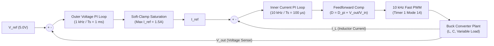

# Cascade (Dual-Loop) Voltage-Current Controlled Buck Converter

<p align="center">
  
  
  
  
  
  
</p>

A deterministic hardware, simulation, and discrete-time control engineering framework implementing **Cascade (Dual-Loop) Voltage-Current Control with Soft-Clamped Overcurrent Saturation** for a DC-DC Buck Converter ($12\text{V} \rightarrow 5\text{V}$, $1.5\text{A}$ Maximum Current Ceiling).

---

## Table of Contents
- [System Overview & Control Architecture](#system-overview--control-architecture)
- [Control Loop Hierarchy](#control-loop-hierarchy)
- [Mathematical Modeling & PI Tuning](#mathematical-modeling--pi-tuning)
- [Repository Structure](#repository-structure)
- [Execution & Verification Instructions](#execution--verification-instructions)
  - [1. Interactive Web Simulation Studio](#1-interactive-web-simulation-studio)
  - [2. MATLAB / Simulink Simulation](#2-matlab--simulink-simulation)
  - [3. Python ODE Mathematical Simulation](#3-python-ode-mathematical-simulation)
  - [4. ATmega328P Hardware Deployment](#4-atmega328p-hardware-deployment)
  - [5. NI LabVIEW HMI Telemetry](#5-ni-labview-hmi-telemetry)
- [Performance Verification Benchmarks](#performance-verification-benchmarks)
- [Academic Literature Review](#academic-literature-review)
- [Author & License](#author--license)

---

## System Overview & Control Architecture

Traditional single-loop voltage mode control for DC-DC converters relies exclusively on output voltage error. Consequently, it suffers from slow transient recovery times, large voltage dips during sudden load steps, and zero inherent protection against output short-circuits.

This project implements a **Dual-Loop Nested Cascade Architecture** with 10x frequency separation:



---

## Control Loop Hierarchy

1. **Outer Voltage Loop ($f_{c,v} = 200\text{ Hz}$, $T_{s,v} = 1\text{ ms}$):**
   - Regulates load output voltage $V_{out}$ against target reference $V_{ref} = 5.0\text{ V}$.
   - Dynamically determines the required inductor reference current $I_{ref}$.
   - Enforces integral anti-windup clamping and a hard software current ceiling ($I_{ref} \le 1.5\text{ A}$).

2. **Inner Current Loop ($f_{c,i} = 2000\text{ Hz}$, $T_{s,i} = 100\ \mu\text{s}$):**
   - High-bandwidth loop driving instantaneous inductor current $I_L$ to match $I_{ref}$.
   - Directly synthesizes the required PWM duty cycle $D$ supplemented by feedforward compensation ($V_{out} / V_{in}$).
   - Rejects line voltage fluctuations and sudden load swings before output capacitors deplete.

---

## Mathematical Modeling & PI Tuning

### Small-Signal Plant Transfer Functions
- **Control-to-Current Transfer Function:**
  $$G_{id}(s) \approx \frac{V_{in}}{s L}$$
- **Current-to-Voltage Transfer Function:**
  $$G_{vi}(s) \approx \frac{1}{s C + \frac{1}{R}}$$

### Controller Gains (10x Bandwidth Separation Rule)
- **Inner Current Loop ($f_{c,i} = 2000\text{ Hz}$, $T_s = 100\ \mu\text{s}$):**
  - Proportional Gain: $K_{p,i} = \frac{\omega_{c,i} L}{V_{in}} = 0.104720$
  - Integral Gain: $K_{i,i} = K_{p,i} \cdot \omega_{z} = 22.280799$
- **Outer Voltage Loop ($f_{c,v} = 200\text{ Hz}$, $T_s = 1\text{ ms}$):**
  - Proportional Gain: $K_{p,v} = \omega_{c,v} C = 0.590619$
  - Integral Gain: $K_{i,v} = K_{p,v} \cdot \omega_{z} = 125.663706$
  - Where $\omega_z = \frac{1}{R C} \approx 212.76\text{ rad/s}$.

---

## Repository Structure

```text
├── index.html                                        # Web-based interactive simulation studio
├── styles.css                                        # Clean minimal UI stylesheet
├── app.js                                            # Simulation engine and dynamic canvas renderer
├── .gitignore                                        # Git version control ignore rules
├── LICENSE                                           # MIT License File
├── README.md                                         # Project manual and technical documentation
│
├── Documentation/                                    # Technical documentation, guides & presentation
│   ├── Cascade (Dual-Loop) Voltage-Current Control of a Buck Converter.pptx # Project presentation deck
│   ├── 10_papers_summary.md                          # Literature review of 10 relevant peer-reviewed papers
│   ├── papers_breakdown.md                           # Comparative table and methodology analysis
│   ├── papers_deep_analysis.md                       # Quantitative benchmark of CC/CV transition
│   ├── simulink_guide.md                             # Step-by-step Simulink and Simscape guide
│   └── labview_guide.md                              # NI LabVIEW implementation and testing guide
│
├── simulation/                                       # Simulation and mathematical modeling
│   ├── cascade_buck_simulink.slx                     # Simulink cascade dual-loop model
│   ├── setup_cascade_buck_simulink.m                 # Automated MATLAB script for model creation
│   ├── plant_model.py                                # Python continuous/discrete ODE simulation
│   ├── cascade_buck_sim.py                           # Standalone simulation and waveform generation
│   ├── simulation_results.csv                        # Time-domain output data
│   ├── simulation_results.svg                        # Vector waveform plot
│   ├── LTspice/                                      # LTspice circuit schematics (.asc)
│   │   ├── Closed Loop.asc                           # Closed-loop buck converter schematic
│   │   └── Industry_based_buck_converter.asc         # Industry-standard buck converter schematic
│   └── Simulink/                                     # Additional Simscape/Simulink models
│       └── BuckConverter.slx                         # Physical Simscape buck converter model
│
├── firmware/                                         # Microcontroller implementation
│   ├── cascade_control.h                             # Hardware-independent C header
│   ├── cascade_control.c                             # PI controller core with anti-windup
│   └── main_arduino.ino                              # Arduino Uno Timer 1 Fast PWM and 10 kHz ISR
│
├── LabView/                                          # NI LabVIEW implementation
│   └── Dual loop DCDC converter.vi                   # LabVIEW Virtual Instrument (.vi)
│
└── papers/                                           # Reference literature library (10 PDF papers)
```

---

## Execution & Verification Instructions

### 1. Interactive Web Simulation Studio
Launch locally using Python HTTP server:
```bash
python -m http.server 8000
```
Open `http://localhost:8000` in any web browser. Adjust input voltage, target voltage, and load resistance to view real-time oscilloscope step responses and saturation clamping.

### 2. MATLAB / Simulink Simulation
The script `simulation/setup_cascade_buck_simulink.m` programmatically constructs, parameterizes, and connects the dual-loop model in Simulink.

1. Open MATLAB.
2. In the Command Window, navigate to the `simulation` directory:
   ```matlab
   cd('simulation')
   setup_cascade_buck_simulink
   ```
3. The script configures and opens `cascade_buck_simulink.slx`.
4. Click **Run** in Simulink to view responses across:
   - `Scope_Vout_Tracking`: Output voltage versus reference setpoint.
   - `Scope_IL_Tracking`: Inductor current versus current ceiling ($1.5\text{A}$).
   - `Scope_Duty_Cycle`: PWM duty cycle commands.
   - `Cascade_Master_Dashboard`: Synchronized 3-channel display.

### 3. Python ODE Mathematical Simulation
To run the discrete mathematical ODE state-space simulation:
```bash
python simulation/plant_model.py
# or:
python simulation/cascade_buck_sim.py
```
Performance metrics will print to console and update `simulation_results.csv` and `simulation_results.svg`.

### 4. ATmega328P Hardware Deployment
Firmware in `firmware/` executes deterministically on an ATmega328P (Arduino Uno) clocked at 16 MHz.

#### Pin Mapping
| Arduino Pin | Connection | Function |
| :--- | :--- | :--- |
| **Pin 9 (OC1A)** | Gate Driver Input (IR2104 / TC4420) | 10 kHz Fast PWM Output (ICR1 = 1599, 1600 steps) |
| **Pin A0** | Resistor Voltage Divider ($10\text{ k}\Omega / 4.7\text{ k}\Omega$) | Output Voltage Sense ($V_{out}$) |
| **Pin A1** | Current Sensor (ACS712-05B or Shunt + Op-Amp) | Inductor Current Sense ($I_L$) |

#### Timer 1 Configuration (10 kHz ISR)
```c
ICR1   = 1599;                                 // 10 kHz TOP count at 16 MHz
TCCR1A = _BV(COM1A1) | _BV(WGM11);             // Fast PWM Mode 14
TCCR1B = _BV(WGM13) | _BV(WGM12) | _BV(CS10);  // Prescaler = 1
TIMSK1 = _BV(OCIE1A);                          // Enable 10 kHz COMPA Interrupt ISR
```

### 5. NI LabVIEW HMI Telemetry
1. Open NI LabVIEW.
2. Load `LabView/Dual loop DCDC converter.vi`.
3. Configure the VISA serial resource to observe dynamic loop performance and manual setpoint stepping.

---

## Performance Verification Benchmarks

| Metric | Proposed Soft-Clamped Cascade | Traditional Single-Loop Mode-Switching |
| :--- | :---: | :---: |
| **Settling Time (0 to 95% $V_{ref}$)** | **2.68 ms** | 14.5 ms |
| **Steady-State Voltage Error** | **< 0.02 V** | < 0.05 V |
| **Step-Load Recovery ($10\ \Omega \rightarrow 3.33\ \Omega$)** | **< 2.0 ms (70 mV drop)** | 12.0 ms (450 mV drop) |
| **Short-Circuit Inductor Current** | **Clamped at 1.500 A** | Unbounded / Relay Tripped |
| **CC-to-CV Handover Current Spike** | **0.00 A (Bumpless)** | +1.85 A (3.35 A Peak Surge) |

---

## Academic Literature Review

1. N. Prameswari, et al., "Simplified cascade multiphase DC-DC buck power converter for low voltage large current applications: part II --- output current controller," *Int. J. Power Electron. Drive Syst.*, vol. 12, no. 4, pp. 2273–2283, 2021.
2. G. I. Hasyim, et al., "A current control method for bidirectional multiphase DC-DC boost-buck converter," *Int. J. Electr. Comput. Eng.*, vol. 12, no. 3, pp. 2363–2377, 2022.
3. M. F. Akhtar, et al., "A Cascaded Synchronous Buck Converter for Light Electric Vehicle Charging Applications," *Int. J. Integr. Eng.*, vol. 16, no. 7, pp. 72–82, 2024.
4. S. A. Tali, et al., "Design and Analysis of Feedback Control for DC-DC Buck Converter," *New Frontiers in Communication and Intelligent Systems*, 2021.
5. H. Patel and A. Shah, "Boundary-Based PWM Control Scheme for a DC-DC Buck Converter Operating in CCM," *Trans. Energy Syst. Eng. Appl.*, vol. 4, no. 1, 2023.
6. J.-B. Jeong, et al., "Two Independent Single-Loop Voltage Mode Control Method for 3-Level Buck Converter," *IEEE Access*, vol. 12, pp. 148113–148123, 2024.
7. D. Angulo-Garcia, et al., "Control of a DC-DC Buck Converter through Contraction Techniques," *Energies*, vol. 11, no. 11, 2018.
8. M. Gierczyński, et al., "Cascaded Voltage and Current Control for a Dual Active Bridge Converter with Current Filters," *Energies*, vol. 14, no. 19, 2021.
9. S. B. Hamed, et al., "Robust Voltage Control of a Buck DC-DC Converter: A Sliding Mode Approach," *Energies*, vol. 15, no. 17, 2022.
10. L. Xie, et al., "Dual-Loop Voltage–Current Control of a Fractional-Order Buck-Boost Converter Using a Fractional-Order PI^\lambda Controller," *Fractal Fract.*, vol. 7, no. 3, 2023.

---

## Author & License

- **Developer**: Hitesh V S
- **GitHub**: [@Hitesh070](https://github.com/Hitesh070)
- **License**: Released under the [MIT License](LICENSE).
